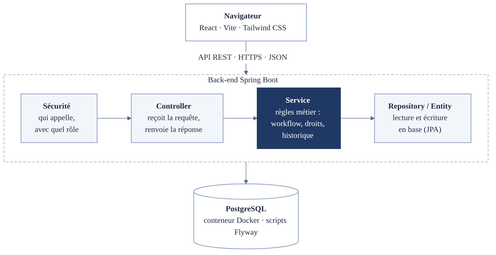

# DemandFlow — Document d'architecture

| Rubrique | Détail |
|---|---|
| Projet | DemandFlow, application web de gestion des demandes d'approvisionnement internes |
| Document | Architecture technique et justification des choix |
| Version | 1.0 |
| Date | 31/10/2026 |
| Dernière mise à jour | 08/11/2026 |
| Auteure | Gabrielle Kibouka Seinzor |
| Contexte | Titre Concepteur Développeur d'Applications (CDA), ADRAR Toulouse, 2026-2027 |
| Statut | Architecture retenue ; points ouverts listés en fin de document |

## Sommaire

1. [Objet du document](#1-objet-du-document)
2. [Vue d'ensemble](#2-vue-densemble)
3. [Argumentaire par couche](#3-argumentaire-par-couche)
4. [Choix transversaux](#4-choix-transversaux)
5. [Conventions de nommage](#5-conventions-de-nommage)
6. [Entités principales](#6-entités-principales)
7. [Positionnement par rapport au modèle MVC](#7-positionnement-par-rapport-au-modèle-mvc)
8. [Points ouverts](#8-points-ouverts)
9. [Glossaire](#9-glossaire)

## 1. Objet du document

Ce document décrit l'architecture technique de DemandFlow : les composants de l'application, leurs responsabilités et la manière dont ils communiquent. Il justifie chaque choix pour qu'il puisse être relu, discuté et défendu. Les schémas validés y sont ajoutés au fur et à mesure de la conception.

## 2. Vue d'ensemble

La requête descend couche par couche et la réponse remonte par le même chemin. Le Service, en couleur, est le cœur de DemandFlow : c'est là que vivent les règles du client.

## 3. Argumentaire par couche

Chaque couche répond à une seule question : le code reste lisible, testable, et une modification ne casse pas le reste.

### Front-end (React, Vite, Tailwind CSS)

- **Rôle :** afficher les écrans (connexion, liste, détail) et envoyer des requêtes à l'API.
- **Pourquoi React :** l'interface est faite de composants réutilisables (bouton, badge de statut, liste) et se met à jour sans recharger la page.
- **Pourquoi Vite et Tailwind :** démarrage rapide en développement, et le design system (couleurs des statuts, espacements) est défini une fois puis réutilisé.
- **Limite :** le front masque les boutons interdits, mais ne décide jamais d'un droit.
- **Évolution prévue :** migration vers React avec TypeScript. Le typage décrit les données échangées avec l'API (les types reprennent les champs du dictionnaire de données), ce qui rend le code plus sûr à manipuler. Elle se fera progressivement, fichier par fichier, une fois le front de base terminé. Elle ne concerne pas le back-end, déjà typé en Java.

### API REST (HTTPS, JSON)

- **Rôle :** c'est le contrat entre le front et le back, avec ses adresses (`GET /requests`, `PUT /requests/12/cancellation`) et le format des échanges.
- **Pourquoi :** le front et le back sont deux applications séparées (dossiers `frontend` et `backend` du dépôt). Elles ne se connaissent que par ce contrat, donc chacune peut évoluer seule.
- JSON est lisible et compris par JavaScript comme par Java. HTTPS chiffre les échanges, indispensable pour les mots de passe.

### Sécurité

- **Rôle :** savoir qui appelle et avec quel rôle (Employé, Chef de service, Validateur, Administrateur), avant que la requête atteigne le Controller.
- **Pourquoi côté back :** un utilisateur peut contourner l'interface et envoyer la requête à la main. Seul le back peut vraiment refuser.
- **Authentification par JWT :** un jeton signé, envoyé à chaque requête, que le serveur vérifie sans rien mémoriser. Choix du 08/11/2026, adapté à un front et un back séparés.

### Controller

- **Rôle :** recevoir la requête, vérifier que les données sont bien formées, appeler le Service et renvoyer la réponse.
- **Pourquoi sans règle métier :** une règle écrite ici serait recopiée dans chaque route et finirait par se contredire.

### Service

- **Rôle :** appliquer les règles de DemandFlow. Transitions du workflow (Soumise, Visée, Validée, Traitée, Livrée, plus Rejetée et Annulée), droits sur chaque demande, motif obligatoire au rejet, commentaire obligatoire à l'étape Traitée.
- **Pourquoi ici :** c'est la seule couche qui connaît les règles du client. Elles sont écrites à un seul endroit : si une règle change, on modifie un seul fichier.

### Repository et Entity

- **Rôle :** lire et écrire en base. Une Entity est une classe Java qui correspond à une table. Le Repository (Spring Data JPA) génère le SQL.
- **Pourquoi :** on manipule des objets Java plutôt que du SQL écrit à la main, et seule cette couche dépend de la base.

### Base PostgreSQL

- **Rôle :** conserver durablement les demandes, les utilisateurs, les services et l'historique.
- **Pourquoi :** une base relationnelle convient à des données liées entre elles (une demande appartient à un employé et à un service), et PostgreSQL permet de faire respecter les règles simples directement en base (contraintes `CHECK`, unicité, index partiels), même si le code se trompe. Elle tourne dans un conteneur Docker, avec Adminer pour la consulter. Le schéma est construit par des scripts SQL versionnés (Flyway) ; Hibernate vérifie seulement qu'il correspond aux entités.

## 4. Choix transversaux

Quatre principes expliquent le découpage, et chacun se défend à l'oral.

- **Séparation des responsabilités :** chaque couche a un seul travail. On peut tester, comprendre et modifier une couche sans toucher aux autres.
- **Workflow uniquement dans le Service :** les transitions de statut et les droits sont écrits une seule fois. Ni le front ni la base n'ont à les connaître.
- **DTO entre le Controller et l'Entity :** on choisit les champs qui sortent. L'Entity utilisateur contient un mot de passe, son DTO n'en contient pas, donc il ne peut pas fuiter.
- **Droits contrôlés côté back :** le front masque des boutons pour le confort, le back refuse pour de vrai.

### Exemple de bout en bout : annuler une demande

1. **Sécurité :** le jeton est valide et l'utilisateur a le rôle Employé.
2. **Controller :** reçoit `PUT /requests/12/cancellation` et appelle le Service.
3. **Service :** vérifie que l'utilisateur est l'auteur de la demande 12 et que son statut est Soumise. Sinon il refuse.
4. **Repository :** écrit le statut Annulée en base, puis la réponse remonte jusqu'au navigateur.

## 5. Conventions de nommage

Le code est nommé en anglais, et tout ce que l'utilisateur lit à l'écran est en français. Le back-end envoie des codes anglais ; le front les traduit en libellés français à l'affichage, à partir d'un seul fichier (`constants/labels.js`).

| Élément | Dans le code (anglais) | À l'écran (français) |
|---|---|---|
| Statut d'une demande | `SUBMITTED`, `ENDORSED`, `VALIDATED`, `PROCESSED`, `DELIVERED`, `REJECTED`, `CANCELLED` | Soumise, Visée, Validée, Traitée, Livrée, Rejetée, Annulée |
| Rôle | `EMPLOYEE`, `DEPARTMENT_HEAD`, `VALIDATOR`, `ADMIN` | Employé, Chef de service, Validateur, Administrateur |
| Entité | `Request`, `Department` | Demande, Service |
| Adresse d'un écran | `/requests/new` | Créer une demande |

L'entité qui représente un service de l'entreprise s'appelle `Department`, pour ne pas la confondre avec la couche Service. Les noms exacts des champs sont fixés par le dictionnaire de données, qui reste la référence unique.

## 6. Entités principales

Cinq entités sont retenues par le dictionnaire de données (version 1.0). Elles deviennent des classes Java annotées, puis des tables PostgreSQL créées par Flyway.

| Entité | Contenu | Remarque |
|---|---|---|
| `User` (Utilisateur) | Nom, email, rôle, service, mot de passe haché (BCrypt), mot de passe provisoire à changer, compte actif ou désactivé | Le DTO ne contient jamais le mot de passe |
| `Department` (Service) | Nom du service | Un chef de service par service |
| `Request` (Demande) | Titre, quantité, justification, statut, dates, demandeur, service, commentaire de traitement, motif de rejet, version | Statut en énumération Java ; service copié à la création ; colonne de version pour le verrou optimiste |
| `RequestHistory` (Historique) | Demande, auteur de l'action, action, date (l'action suffit, sans ancien ni nouveau statut) | Écrit à chaque action, jamais modifié ni supprimé |
| `Notification` | Destinataire, demande concernée, type, lue ou non | Une par changement de statut et par modification du chef |

Trois décisions de modélisation sont retenues dès maintenant :

- Le statut et le rôle sont des énumérations Java, stockées en texte : les valeurs sont fixes et un changement d'ordre ne décale pas la base, et une contrainte `CHECK` refuse toute autre valeur.
- Le service est copié sur la demande à sa création : si l'employé change de service plus tard, l'historique de la demande ne change pas.
- Une colonne de version sur la demande sert de verrou optimiste : si l'employé annule pendant que le chef vise, la seconde action échoue proprement.

Une seule classe du Service vérifie si une transition est permise pour ce rôle depuis cet état, puis écrit l'historique.

Le commentaire de traitement et le motif de rejet sont deux champs de la demande, sans table séparée en version 1. Les comptes et les services se désactivent, ils ne se suppriment pas, pour conserver les demandes et l'historique. Les mots de passe sont stockés sous forme de hash BCrypt.

## 7. Positionnement par rapport au modèle MVC

DemandFlow n'est pas une application MVC stricte : c'est une architecture client-serveur en couches. React joue le rôle de la vue, séparée du back-end. Le Controller correspond au « C », et Spring s'appuie sur Spring MVC pour sa couche web. En une phrase : architecture en couches, avec Spring MVC pour la couche web.

## 8. Points ouverts

- **Modification d'une demande par le chef :** le cahier des charges demande de conserver la version d'origine ; une table de versions est recommandée, à décider avant le MCD.
- **Réinitialisation du mot de passe :** champs pour un jeton à ajouter par une migration ultérieure (la modification simultanée est déjà réglée par la version optimiste).
- **Demandeur qui est chef de service ou validateur :** en v1, documenter comme limite.

Schémas à ajouter ensuite : diagramme d'états des demandes, MCD, MLD, diagramme de classes, diagramme de séquence. Les autres points ouverts sur les données (rejet depuis le statut Validée, génération de la référence) sont listés dans le dictionnaire de données.

## 9. Glossaire

| Terme | Définition |
|---|---|
| API REST | Interface par laquelle le front-end demande des données ou des actions au back-end, via des adresses et des méthodes HTTP (GET, POST, PUT). |
| BCrypt | Fonction qui transforme un mot de passe en empreinte (hash) impossible à inverser ; on compare les empreintes à la connexion. |
| Controller | Classe qui reçoit les requêtes HTTP et les transmet au Service. |
| DTO | Data Transfer Object : classe limitée aux champs échangés avec le front-end. |
| Entity | Classe Java dont les objets correspondent aux lignes d'une table. |
| Flyway | Outil qui applique les scripts SQL versionnés (V1, V2…) pour construire et faire évoluer la base. |
| JPA | Spécification Java qui fait le lien entre les objets et les tables ; Spring Data JPA génère le SQL. |
| JWT | JSON Web Token : jeton signé qui prouve l'identité de l'utilisateur à chaque requête. |
| Repository | Classe qui lit et écrit les entités en base. |
| Service | Classe qui contient les règles métier. |
| Spring MVC | Module de Spring pour construire la couche web (Controller) d'une application. |
