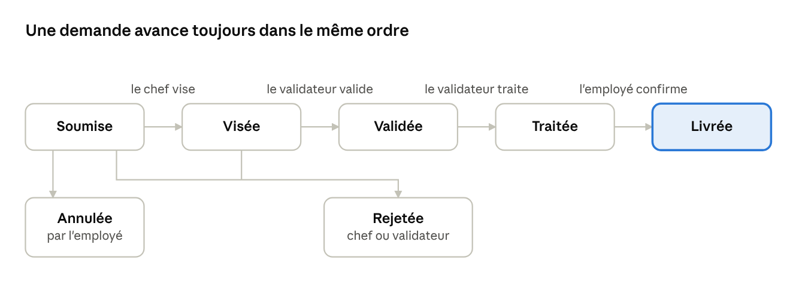

# User stories — DemandFlow

Version 2 — 31/10/2026. Annexe au cahier des charges.
Auteure : Gabrielle Kibouka Seinzor.

## Objet et lecture du document

Ce document réunit les 27 user stories de DemandFlow, mises à jour après les décisions de conception d'octobre 2026. Elles remplacent le premier jet.

Chaque story suit le même modèle : **En tant que** [rôle], **j'ai besoin de** [action], **afin de** [bénéfice]. Elles sont regroupées par thème, dans l'ordre du circuit d'une demande.

La priorité suit la méthode MoSCoW :

- **Must** : indispensable à la première version.
- **Should** : important, mais la première version fonctionne sans.
- **Could** : à faire si le temps le permet.

## Les quatre rôles

DemandFlow compte quatre rôles, chacun attribué par l'administrateur à la création du compte. Le visiteur n'est pas un rôle : c'est toute personne qui n'est pas encore connectée.

| Rôle | Code | Ce qu'il fait |
| --- | --- | --- |
| Employé (demandeur) | `EMPLOYEE` | Crée ses demandes, les suit, les modifie ou les annule tant qu'elles sont Soumises, confirme la réception |
| Chef de service | `DEPARTMENT_HEAD` | Consulte, modifie, vise ou rejette les demandes de son service (un chef par service) |
| Validateur | `VALIDATOR` | Valide, traite ou rejette les demandes visées de tous les services (un seul validateur en v1) |
| Administrateur | `ADMIN` | Crée et gère les comptes et les services |

## Le circuit d'une demande

Une demande part de « Soumise » et suit les étapes dans l'ordre jusqu'à « Livrée ». Elle peut être rejetée par le chef de service ou le validateur, avec un motif obligatoire, ou annulée par l'employé tant qu'elle est « Soumise ». « Livrée », « Rejetée » et « Annulée » sont les états finaux.

**Transitions autorisées**

| De | Vers | Qui | Condition |
| --- | --- | --- | --- |
| Soumise | Visée | Chef de service | Demande de son service |
| Soumise | Annulée | Employé | Demande qu'il a créée |
| Soumise | Rejetée | Chef de service | Motif obligatoire |
| Visée | Validée | Validateur | — |
| Visée | Rejetée | Validateur | Motif obligatoire |
| Validée | Traitée | Validateur | Commentaire de traitement |
| Traitée | Livrée | Employé | Confirmation « J'ai bien reçu » |

Les étapes où chacun peut rejeter (le chef à « Soumise », le validateur à « Visée ») sont à confirmer.

## A. Accès et compte

Les comptes sont créés par l'administrateur : il n'y a pas d'inscription libre.

| N° | En tant que | J'ai besoin de | Afin de | Priorité |
| --- | --- | --- | --- | --- |
| A1 | Visiteur | me connecter avec mon e-mail et mon mot de passe | accéder à mon espace selon mon rôle | Must |
| A2 | Visiteur | réinitialiser mon mot de passe oublié | retrouver l'accès sans solliciter l'administrateur | Should |
| A3 | Utilisateur connecté | changer mon mot de passe provisoire à la première connexion | sécuriser mon compte | Should |
| A4 | Utilisateur connecté | me déconnecter | protéger mon compte sur un poste partagé | Must |
| A5 | Utilisateur connecté | consulter mon profil (nom, service, rôle) | vérifier mes informations | Could |

## B. Faire une demande (employé)

L'employé peut modifier sa demande tant qu'elle est « Soumise », c'est-à-dire avant que son chef de service la vise, ou l'annuler. Il n'y a ni brouillon ni suppression : l'annulation retire la demande du circuit, mais elle reste consultable avec son historique.

| N° | En tant que | J'ai besoin de | Afin de | Priorité |
| --- | --- | --- | --- | --- |
| B1 | Employé | créer une demande d'approvisionnement (intitulé, quantité…) | obtenir ce dont j'ai besoin | Must |
| B2 | Employé | consulter la liste de mes demandes, filtrée « En cours » ou « Terminées » | m'y retrouver rapidement | Must |
| B3 | Employé | consulter le détail et l'historique d'une demande | savoir où elle en est et qui l'a traitée | Must |
| B4 | Employé | modifier ma demande tant qu'elle est « Soumise » | corriger une erreur de saisie sans tout ressaisir | Should |
| B5 | Employé | annuler ma demande tant qu'elle est « Soumise » | retirer une demande faite par erreur | Must |
| B6 | Employé | confirmer la réception (« J'ai bien reçu ») sur une demande « Traitée » | passer la demande à « Livrée » | Must |
| B7 | Employé | refaire une demande à partir d'une demande rejetée (« Dupliquer ») | ne pas tout ressaisir | Could |

## C. Circuit de validation

Le circuit est linéaire : le chef de service vise, le validateur valide puis traite. L'achat se fait en dehors de l'application ; le validateur en garde la trace dans un commentaire.

| N° | En tant que | J'ai besoin de | Afin de | Priorité |
| --- | --- | --- | --- | --- |
| C1 | Chef de service | consulter les demandes « Soumises » de mon service | savoir lesquelles viser | Must |
| C2 | Chef de service | viser une demande de mon service | la transmettre au validateur | Must |
| C3 | Chef de service | modifier une demande de mon service avant de la viser | corriger une information (l'employé est notifié) | Should |
| C4 | Chef de service ou validateur | rejeter une demande en indiquant un motif obligatoire | que l'employé comprenne la décision | Must |
| C5 | Validateur | consulter les demandes « Visées » de tous les services | savoir lesquelles valider | Must |
| C6 | Validateur | valider une demande visée | autoriser son traitement | Must |
| C7 | Validateur | traiter une demande validée en saisissant un commentaire | informer l'employé de la suite donnée à sa demande | Must |

## D. Suivi, notifications et historique

L'employé est notifié à chaque changement de statut et quand son chef de service modifie sa demande.

| N° | En tant que | J'ai besoin de | Afin de | Priorité |
| --- | --- | --- | --- | --- |
| D1 | Employé | être notifié à chaque changement de statut de ma demande | suivre son avancement sans la rouvrir | Must |
| D2 | Employé | être notifié quand mon chef de service modifie ma demande | savoir ce qui a changé | Must |
| D3 | Utilisateur | consulter mes notifications et les marquer comme lues | garder une boîte claire | Should |
| D4 | Utilisateur concerné | consulter l'historique horodaté d'une demande (qui, quand, quelle action) | tracer toutes les décisions | Must |

## E. Administration

L'administrateur ne participe pas au circuit des demandes : il gère les accès et l'organisation.

| N° | En tant que | J'ai besoin de | Afin de | Priorité |
| --- | --- | --- | --- | --- |
| E1 | Administrateur | créer un compte avec un rôle, un service et un mot de passe provisoire | donner l'accès à un nouvel utilisateur | Must |
| E2 | Administrateur | modifier ou désactiver un compte | tenir les accès à jour | Must |
| E3 | Administrateur | gérer les services (créer, renommer) | refléter l'organisation de l'entreprise | Must |
| E4 | Administrateur | réinitialiser le mot de passe d'un utilisateur | dépanner un collègue bloqué | Should |

## Priorités et hors périmètre

Sur les 27 stories, 19 sont des Must, 6 des Should et 2 des Could.

| Priorité | Nombre | Stories |
| --- | --- | --- |
| Must | 19 | A1, A4, B1 à B3, B5, B6, C1, C2, C4 à C7, D1, D2, D4, E1 à E3 |
| Should | 6 | A2, A3, B4, C3, D3, E4 |
| Could | 2 | A5, B7 |

**Hors périmètre de la première version**

- L'achat et la commande : ils se font en dehors de l'application, le validateur en garde la trace dans un commentaire.
- Le brouillon et la suppression d'une demande : l'employé modifie sa demande tant qu'elle est « Soumise », ou l'annule.
- Un statut « Clôturée » : « Livrée », « Rejetée » et « Annulée » sont les états finaux ; l'archivage serait un affichage, pas un statut.
- L'inscription libre : les comptes sont créés par l'administrateur.
- Un rôle direction, un tableau de bord financier et un seuil budgétaire : retirés du périmètre.

**À confirmer :** le rejet est définitif (l'employé refait une demande). Une demande rejetée ne peut pas être renvoyée pour correction.
